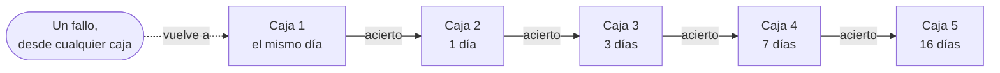

<div align="center">


# Repaso

**Practica para tu entrevista de software.**<br>
897 preguntas en español y en inglés. Sin registro, sin anuncios, sin rastreadores.

[](https://repaso.babylonace.dev/)

[](https://github.com/babylonace/repaso/actions/workflows/deploy.yml)
[](LICENSE)
[](content/LICENSE.md)


[Read in English](README.md)


</div>

## Qué es

Práctica gratis para entrevistas de ingeniería de software, de nivel junior a intermedio: 897 preguntas y 852 términos de glosario en 17 temas. Entras y la primera pregunta ya está ahí.

Tu progreso se queda en tu navegador y funciona sin conexión después de la primera visita. Si lo quieres en otro dispositivo puedes iniciar sesión con Google o GitHub, pero nada depende de eso.

"Repaso" es revisión en español, que es justo lo que hace.

## Qué ofrece

- **Una pregunta al instante.** Responde la de la portada, o pulsa `/` para buscar y `1` a `4` para contestar.
- **"No la sé" también vale.** Ves la respuesta sin adivinar y no cuenta como fallo.
- **Preguntas que vuelven cuando toca.** Cinco cajas, estilo Leitner. Si fallas, vuelve el mismo día. Si aciertas, tarda más.
- **Primero, preguntas de entrevista.** Las nuevas empiezan por lo que preguntan de verdad. ¿Prefieres ir subiendo? Elige "Desde lo básico" y cada tema se abre nivel a nivel.
- **Cuatro modos.** Repaso inteligente, al azar, solo mis fallos, y examen con cronómetro (30, 60 o 90 segundos por pregunta).
- **Temas.** Todas las preguntas de un tema con su estado, para que la noche antes leas solo las que fallaste.
- **Los dos idiomas.** Un botón. La primera visita sigue el idioma de tu navegador, un enlace desde una página en español abre la app en español y el código se queda en inglés.
- **Búsqueda** en preguntas, glosario y temas, en los dos idiomas.
- **Tema claro y oscuro**, instalable y sin conexión después de la primera visita.
- **Privado por defecto.** Sin analítica, y ninguna petición sale del sitio hasta que inicias sesión.

## Capturas

<table>
  <tr>
    <td></td>
    <td></td>
  </tr>
  <tr>
    <td></td>
    <td></td>
  </tr>
</table>


<p align="center">
  
  &nbsp;&nbsp;
  
</p>

Las capturas están en inglés, la web también se ve en español con el botón ES.

## Temas

| Tema | Preguntas | Tema | Preguntas |
|---|---:|---|---:|
| Python | 69 | Seguridad | 50 |
| Java Core | 54 | Frontend y web | 63 |
| Spring, JPA y Java Web | 45 | Cloud y DevOps | 95 |
| Diseño y buenas prácticas | 65 | Maven, Git y SDLC | 35 |
| Backend y APIs | 52 | Testing | 48 |
| Bases de datos y SQL | 59 | Preguntas de comportamiento | 40 |
| Algoritmos y estructuras de datos | 56 | Diseño de sistemas | 46 |
| Fundamentos de ML | 40 | LLMs, RAG y agentes | 40 |
| MLOps y despliegue | 40 | | |

## Cómo funcionan las cajas



Si aciertas, la pregunta sube una caja. Si fallas, vuelve a la caja 1. Cuanto más alta la caja, más tarda en volver a salir.

## ¿Encontraste un error?

Cada pregunta tiene un enlace "Sugerir una corrección" que abre un issue ya rellenado aquí.

Si quieres arreglarlo tú, el contenido es JSON normal. [CONTRIBUTING.md](CONTRIBUTING.md) tiene la versión corta (en inglés):

- `content/questions/<tema>.json`: las preguntas en inglés. Cada una tiene un `id` estable.
- `content/es/questions/<tema>.json`: la versión en español, por `id`. El código se queda en inglés.
- `content/glossary.json` y `content/es/glossary.json`: el glosario.

`npm test` lo comprueba todo: ids, respuestas, enlaces al glosario y que una traducción no cambie nada de código.

## Cómo está hecho

| | |
|---|---|
| Sitio | HTML, CSS y módulos de JavaScript normales. Sin framework y sin dependencias en ejecución |
| Build | Un script pequeño de Node 22 o superior. También escribe una página estática por cada pregunta y tema, y un sitemap, para que los buscadores lo lean sin ejecutar scripts |
| Hosting | GitHub Pages, desplegado por GitHub Actions solo si pasan los tests unitarios y de navegador |
| Cuentas | Opcionales. Firebase en su plan gratis, que se carga solo si alguien inicia sesión. `config.js` sale con las cuentas apagadas, mira [docs/firebase-setup.md](docs/firebase-setup.md) |
| Sin conexión | Un service worker guarda una copia de la app después de la primera visita |
| Seguridad | Content-Security-Policy estricta, sin scripts, fuentes ni estilos de terceros. Un test lo vigila |
| Tests | Tests unitarios y de contenido con `node:test`, tests de navegador con Playwright, y tests de cuentas y reglas en los emuladores de Firebase |
| Diseño | Bricolage Grotesque, Atkinson Hyperlegible y JetBrains Mono, todas autoalojadas. Los efectos (aurora, borde con luz, contadores) están escritos en CSS normal y un poco de JS, y se paran con "reducir movimiento". Mira [docs/design.md](docs/design.md) |

La investigación detrás de estas decisiones, los límites gratis y qué hacer al acercarse a ellos están en [docs/research.md](docs/research.md). El mantenimiento está en [docs/maintenance.md](docs/maintenance.md).

## Ejecutarlo en local

Necesitas Node 22 o superior. No hay dependencias que instalar.

```bash
npm run serve   # construye y sirve en http://localhost:4173
npm test        # tests de lógica y contenido
```

Los tests de navegador usan Playwright, que dejo fuera del proyecto a propósito:

```bash
npm i --no-save playwright && npx playwright install chromium
npm run e2e            # móvil y escritorio, sin servicio de cuentas
npm run e2e:accounts   # registro, cierre de sesión y reglas de seguridad, en los emuladores de Firebase
npm run media          # redibuja el GIF, las capturas y la imagen para compartir (también necesita ffmpeg)
```

Cómo se comprueba y se fusiona cada cambio (en inglés): [docs/how-this-repo-is-developed.md](docs/how-this-repo-is-developed.md).

## Licencia

Código: [MIT](LICENSE). Preguntas y glosario: [CC BY 4.0](content/LICENSE.md). Fuentes: SIL Open Font License, incluida junto a los archivos de las fuentes.

AI-assisted.
