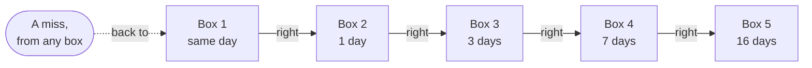

<div align="center">


# Repaso

**Practice for your software interview.**<br>
897 questions in English and Spanish. No signup, no ads, no trackers.

[](https://repaso.babylonace.dev/)

[](https://github.com/babylonace/repaso/actions/workflows/deploy.yml)
[](LICENSE)
[](content/LICENSE.md)


[Leer en español](README.es.md)


</div>

## What it is

Free practice for software engineering interviews, junior to mid level: 897 questions and 852 glossary terms across 17 topics. You open it and the first question is already there.

Your progress stays in your browser, and it works offline after the first visit. If you want it on another device you can sign in with Google or GitHub, but nothing depends on that.

"Repaso" means review in Spanish, which is all this is.

## What you get

- **A question right away.** Answer the one on the home page, or press `/` to search and `1` to `4` to answer.
- **"I don't know" is an answer too.** See the answer without guessing. It doesn't count as a miss.
- **Questions that come back when they should.** Five boxes, Leitner style. Miss one and it returns the same day, get it right and it waits longer.
- **Interview questions first.** New questions start with what interviewers ask. Want to build up instead? Pick "From the basics" and each topic opens level by level.
- **Four modes.** Smart review, random, only my misses, and an exam with a timer (30, 60 or 90 seconds per question).
- **Topics.** Every question of a topic with its status, so the night before you can read just the ones you missed.
- **Both languages.** One button. The first visit follows your browser language, a link from a Spanish page opens the app in Spanish, and code stays in English.
- **Search** over questions, glossary and topics, in both languages.
- **Light and dark theme**, installable, offline after the first visit.
- **Private by default.** No analytics, and no request leaves the site until you sign in.

## Screenshots

<table>
  <tr>
    <td></td>
    <td></td>
  </tr>
  <tr>
    <td></td>
    <td></td>
  </tr>
</table>


<p align="center">
  
  &nbsp;&nbsp;
  
</p>

## Topics

| Topic | Questions | Topic | Questions |
|---|---:|---|---:|
| Python | 69 | Security | 50 |
| Java Core | 54 | Frontend & Web | 63 |
| Spring, JPA & Java Web | 45 | Cloud & DevOps | 95 |
| Design & Practices | 65 | Maven, Git & SDLC | 35 |
| Backend & APIs | 52 | Testing | 48 |
| Databases & SQL | 59 | Behavioral | 40 |
| Algorithms & DS | 56 | System Design | 46 |
| ML fundamentals | 40 | LLMs, RAG & agents | 40 |
| MLOps & serving | 40 | | |

## How the review boxes work



A right answer moves a question up one box. A miss sends it back to box 1. The higher the box, the longer it waits before it shows up again.

## Found a mistake?

Every question has a "Suggest a correction" link that opens a prefilled issue here.

If you want to fix it yourself, the content is plain JSON. [CONTRIBUTING.md](CONTRIBUTING.md) has the short version:

- `content/questions/<topic>.json`: the English questions. Each one has a stable `id`.
- `content/es/questions/<topic>.json`: the Spanish version, by `id`. Code stays in English.
- `content/glossary.json` and `content/es/glossary.json`: the glossary.

`npm test` checks everything: ids, answers, glossary links, and that a translation does not change any code.

## How it's built

| | |
|---|---|
| Site | Plain HTML, CSS and JavaScript modules. No framework, no runtime dependencies |
| Build | One small Node script, Node 22 or newer. Also writes a static page for every question and topic, plus a sitemap, so search engines can read it without running scripts |
| Hosting | GitHub Pages, deployed by GitHub Actions only after unit and browser tests pass |
| Accounts | Optional. Firebase on its free plan, loaded only when someone signs in. `config.js` ships with accounts off, see [docs/firebase-setup.md](docs/firebase-setup.md) |
| Offline | A service worker keeps a copy of the app after the first visit |
| Security | Strict Content-Security-Policy, no third-party scripts, fonts or styles. A test guards that |
| Tests | Unit and content tests with `node:test`, browser tests with Playwright, and account and rules tests on the Firebase emulators |
| Design | Bricolage Grotesque, Atkinson Hyperlegible and JetBrains Mono, all self-hosted. Effects like the aurora, border beam and count-up are written in plain CSS and a little JS, and stop under reduced motion. See [docs/design.md](docs/design.md) |

The research behind these choices, the free limits and what to do when getting close to them are in [docs/research.md](docs/research.md). Upkeep is in [docs/maintenance.md](docs/maintenance.md).

## Run it locally

You need Node 22 or newer. There are no dependencies to install.

```bash
npm run serve   # builds and serves on http://localhost:4173
npm test        # logic and content tests
```

Browser tests use Playwright, which I keep out of the project on purpose:

```bash
npm i --no-save playwright && npx playwright install chromium
npm run e2e            # mobile and desktop, without any account service
npm run e2e:accounts   # sign-up, sign-out and security rules, on the Firebase emulators
npm run media          # redraws the GIF, screenshots and share image (also needs ffmpeg)
```

How changes are checked and merged: [docs/how-this-repo-is-developed.md](docs/how-this-repo-is-developed.md).

## License

Code: [MIT](LICENSE). Questions and glossary: [CC BY 4.0](content/LICENSE.md). Fonts: SIL Open Font License, included next to the font files.

AI-assisted.
